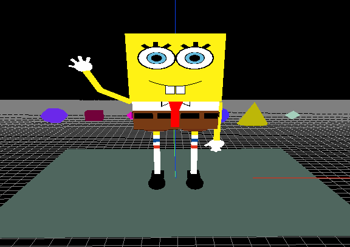

# OpenGLSpongeBob

An OpenGL practice project: a 3D scene in C++ with [freeglut](https://freeglut.sourceforge.net/), where SpongeBob is built only from simple shapes (cubes, cylinders, spheres and polygons) and a Bézier curve for the mouth, over a reference grid with the X, Y and Z axes.

## Features

- **Articulated character:** the left arm swings through a shoulder, elbow, wrist and hand with fingers chain. The right arm uses the same setup in a fixed pose.
- **Time-based animation:** the arm pose comes from the clock, so speed is the same at any frame rate.
- **Orbital camera with a movable pivot:** orbit, pan and zoom, always around the point you moved.
- **On-screen controls panel:** lists the shortcuts and can be hidden.
- **Colored shapes in the background:** they change color every 1 second.

## Controls

| Input | Action |
| --- | --- |
| Left mouse + drag | Orbit around the character |
| Right mouse + drag | Pan the camera (the pivot follows) |
| Scroll or `W` / `S` | Zoom |
| Arrow keys | Orbit |
| `A` / `D` / `Q` / `E` | Pan the camera (the pivot follows) |
| `R` | Reset the camera |
| `H` | Show or hide the controls panel |
| `ESC` | Quit |

The controls panel appears in the corner of the window when the program starts.

## Building

C++ project using freeglut. In Dev-C++, open `Preview.dev`; the linker uses `-lopengl32 -lfreeglut -lglu32`.

With the Microsoft compiler (MSVC), define `_USE_MATH_DEFINES` (the code uses `M_PI`) and create a `glut.h` file that includes `<freeglut.h>`, since the code includes both headers by name.

## Files

| File | Role |
| --- | --- |
| `main.cpp` | Window, projection, global variables and main loop |
| `controllers.h` | Camera (orbit, pan, zoom, pivot), mouse and keyboard |
| `hud.h` | 2D controls panel |
| `drawCall.h` | Per-frame draw call |
| `tickCall.h` | 16 ms timer that updates the animation |
| `bobSponge.h` | Character, arms and the arm animation |
| `basicObjects.h` | Colored geometric shapes in the background |
| `colorPicker.h` | Random colors, once per second |
| `grid.h` | Reference grid and axes |
